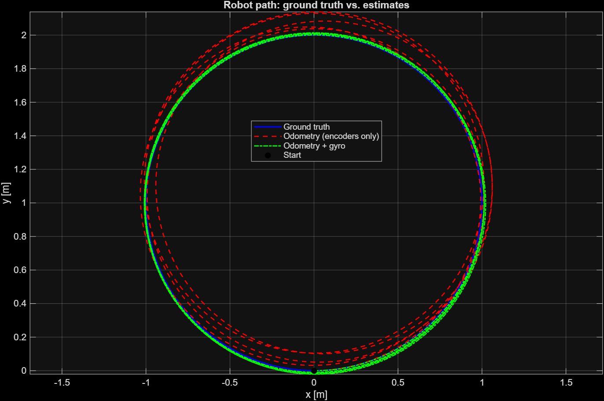
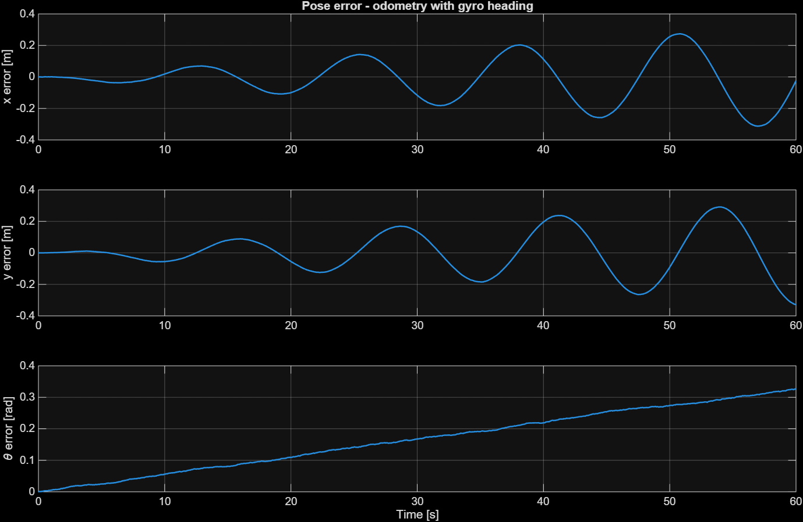

# Differential Drive Mobile Robot – Simulink Test Kit

A step-by-step Simulink test kit for differential drive mobile robots. The goal is to model kinematics, actuators, sensors, localization, planning and control in simulation, so that real-world behavior can be anticipated **before working on hardware**.

> **Status:** Work in progress. Tasks 1–2 (kinematics, odometry, gyro) are in place; see the [Roadmap](#roadmap).

---

## Requirements

- MATLAB & Simulink (developed on R2026a)
- Robotics System Toolbox (Differential Drive Kinematic Model block)
- Navigation Toolbox (planned for later tasks)

## Getting Started

1. Clone the repository and open the folder in MATLAB.
2. Load the robot parameters:
   ```matlab
   init_robot
   ```
   > If the model's *InitFcn* callback is set to `init_robot` (*Model Settings → Model Properties → Callbacks*), this runs automatically before every simulation.
3. Open and run the model:
   ```matlab
   open_system('mobile_robot_model.slx')
   out = sim('mobile_robot_model');
   ```
4. Plot the true path vs. odometry estimate:
   ```matlab
   s = squeeze(out.robotState.Data); if size(s,1)==3, s = s.'; end
   p = squeeze(out.odomPose.Data);   if size(p,1)==3, p = p.'; end
   plot(s(:,1), s(:,2), 'b', p(:,1), p(:,2), 'r--'); axis equal; grid on
   legend('Ground truth', 'Odometry')
   ```

## Robot Parameters (`init_robot.m`)

| Parameter | Value | Description |
|---|---|---|
| `r` | 0.045 m | Wheel radius |
| `L` | 0.2194 m | Track width (distance between wheels) |
| `x0` | [0; 0; 0] | Initial pose [x; y; θ] |
| `Ts` | 0.01 s | Sample time (fixed-step, ode4) |

## Model Overview

```
v, ω command ─► Inverse Kinematics ─► Motor lag 1/(0.2s+1) ─► Saturation ±20 rad/s ─► Diff Drive Kinematic Model ─► true pose
                                                                       │
                                     encoder noise ─► Odometry (+ gyro) ─► Integrator ─► estimated pose ─► error vs. true pose
```

| Block | Purpose |
|---|---|
| Inverse kinematics (MATLAB Function) | Converts linear/angular velocity (v, ω) into left/right wheel speeds |
| Transfer Fcn + Saturation | First-order motor response and wheel speed limits |
| Differential Drive Kinematic Model | Ground-truth robot motion |
| Odometry (MATLAB Function + Integrator) | Pose estimate from (noisy) wheel encoders |
| Gyro model | True ω + Gaussian noise + constant bias |
| Odometry + gyro | Heading from gyro, forward speed from encoders |

## Verification Tests

Wheel speeds in rad/s, 20 s simulation:

| Test | Left | Right | Expected result |
|---|---|---|---|
| A – straight | 11.111 | 11.111 | Straight line, x = 10 m at t = 20 s |
| B – left circle | 9.892 | 12.330 | Circle, R = 1 m, center (0, 1), period ≈ 12.6 s |
| C – spin | −1.219 | 1.219 | Rotation in place |
| D – right circle | 12.330 | 9.892 | Circle, R = 1 m, clockwise |

For constant v and ω the robot follows a circle with radius **R = v/ω** and period **T = 2π/ω**.

## Results So Far

- **Noise-free odometry** matches ground truth exactly (error ≈ 0).
- **Encoder noise** (σ = 0.5 rad/s): heading error grows as a random walk (~0.3 rad after 60 s); x/y errors oscillate with the lap period and grow with the heading error.
- **Gyro heading** (σ = 0.02 rad/s, bias 0.005 rad/s): noise is largely removed, but bias causes a linear heading drift (≈ −0.3 rad after 60 s).
- **Conclusion:** dead reckoning alone always drifts → an absolute position sensor and an EKF are needed (next task).

Run `plot_results` after a simulation to regenerate these figures.






## Roadmap

- [x] **Task 1 – Robot model:** kinematics, inverse kinematics, motor lag, saturation
- [ ] **Task 2 – Localization:** ~~odometry~~ ✓, ~~gyro~~ ✓, position sensor, EKF
- [ ] **Task 3 – Obstacle detection & tracking:** lidar simulation, clustering, Kalman tracking
- [ ] **Task 4 – Path planning:** A*, RRT*, Hybrid A* on occupancy maps
- [ ] **Task 5 – Control:** PID, Pure Pursuit, Stanley, LQR, MPC comparison

## Repository Structure

```
├── init_robot.m      # robot parameters
├── plot_results.m    # result figures for this README
├── mobile_robot_model.slx    # Simulink model
├── images/           # screenshots for this README
├── .gitignore
└── .gitattributes
```
