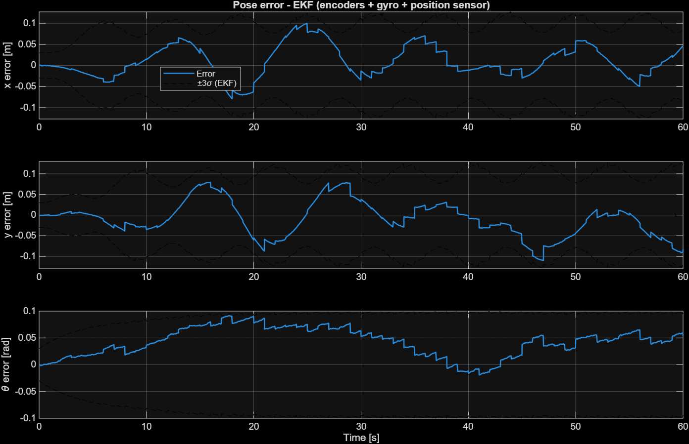
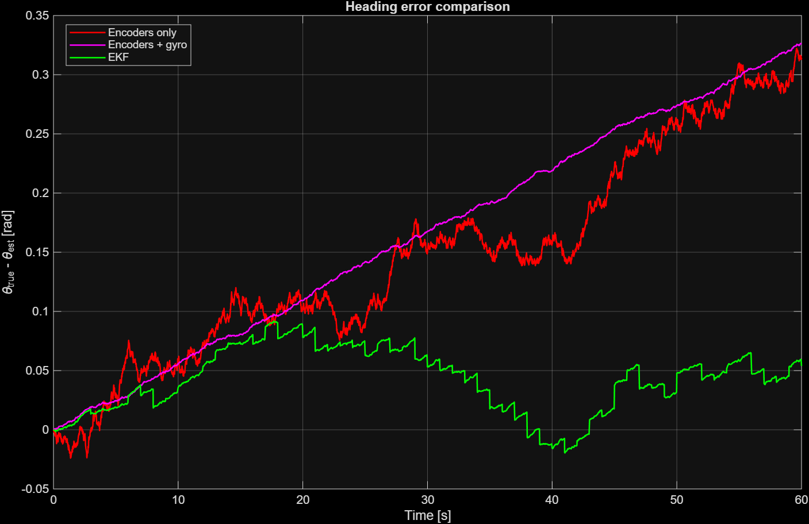
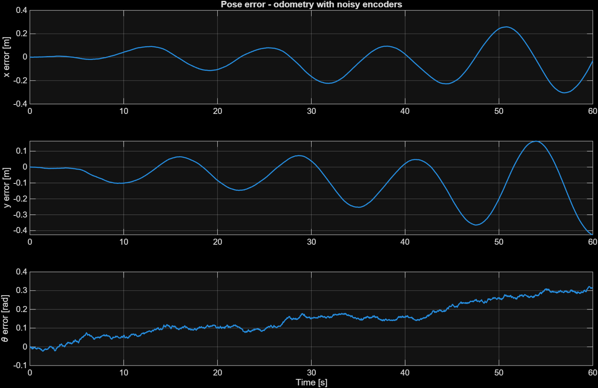

# Differential Drive Mobile Robot – Simulink Test Kit

A step-by-step Simulink test kit for differential drive mobile robots. The goal is to model kinematics, actuators, sensors, localization, planning and control in simulation, so that real-world behavior can be anticipated **before working on hardware**.

> **Status:** Work in progress. Task 1 (robot model) and Task 2 (localization with EKF) are complete; see the [Roadmap](#roadmap).

---

## Requirements

- MATLAB & Simulink **R2026a**
- Robotics System Toolbox (Differential Drive Kinematic Model block)
- Navigation Toolbox (planned for later tasks)

## Getting Started

1. Clone the repository and open the folder in MATLAB (keep it as the *Current Folder*).
2. Load the parameters:
   ```matlab
   init_robot
   ```
   > Tip: set *Model Settings → Model Properties → Callbacks → InitFcn* to `init_robot` so it runs automatically before every simulation.
3. Run the model and generate the result figures:
   ```matlab
   out = sim('mobile_robot_model');
   plot_results
   ```
   `plot_results` prints an error summary table and saves all figures to `images/`.

## Parameters (`init_robot.m`)

| Parameter | Value | Description |
|---|---|---|
| `r` | 0.045 m | Wheel radius |
| `L` | 0.2194 m | Track width (distance between wheels) |
| `x0` | [0; 0; 0] | Initial pose [x; y; θ] |
| `Ts` | 0.01 s | Base sample time: simulation, encoders, gyro, EKF (fixed-step, ode4) |
| `posSensor` | `'demo'` | Absolute position sensor profile (see below) |
| `sig_pos` | profile | Position sensor noise σ [m] |
| `Ts_pos` | profile | Position sensor sample time [s] |

**Position sensor profiles** – the sensor is modeled generically as *true position + Gaussian noise, sampled every `Ts_pos`*, so one block covers several real technologies:

| Profile | σ | Rate | Represents |
|---|---|---|---|
| `demo` | 0.10 m | 1 Hz | Teaching setting – drift between updates is clearly visible |
| `uwb` | 0.10 m | 10 Hz | UWB indoor positioning |
| `rtk` | 0.02 m | 10 Hz | RTK-GNSS (outdoor) |
| `lidar_loc` | 0.03 m | 10 Hz | Lidar map-based localization (AMCL / scan matching) |

## Model Overview

```
v, ω ─► Inverse kinematics ─► Motor lag + saturation ─► Diff Drive Kinematic Model ─► ground-truth pose
                                     │                                    │
                           encoders + noise                 gyro (ω + noise + bias)      position sensor
                                     │                                    │            (x, y + noise, every Ts_pos)
                                     ▼                                    ▼                       │
              Odometry (encoders) │ Odometry + gyro │ EKF (encoders + gyro + position sensor) ◄─────┘
                                     └──────── estimated poses ─► error vs. ground truth
```

| Block | Purpose |
|---|---|
| Inverse kinematics (MATLAB Function) | Converts linear/angular velocity (v, ω) into left/right wheel speeds |
| Transfer Fcn + Saturation | First-order motor response (τ = 0.2 s) and wheel speed limits (±20 rad/s) |
| Differential Drive Kinematic Model | Ground-truth robot motion |
| Encoder model | Wheel speed + Gaussian noise (σ = 0.5 rad/s) |
| Gyro model | True ω + Gaussian noise (σ = 0.02 rad/s) + constant bias (−0.005 rad/s) |
| Absolute position sensor | True x, y + Gaussian noise, sampled every `Ts_pos` |
| Odometry / Odometry + gyro | Dead-reckoning pose estimates (MATLAB Function + Integrator) |
| **EKF** | Fuses encoders + gyro (prediction, every `Ts`) with the position sensor (correction, every `Ts_pos`) – see [docs/EKF.md](docs/EKF.md) |

## Verification Tests (Task 1)

Wheel speeds in rad/s, 20 s simulation:

| Test | Left | Right | Expected result |
|---|---|---|---|
| A – straight | 11.111 | 11.111 | Straight line, x = 10 m at t = 20 s |
| B – left circle | 9.892 | 12.330 | Circle, R = 1 m, center (0, 1), period ≈ 12.6 s |
| C – spin | −1.219 | 1.219 | Rotation in place |
| D – right circle | 12.330 | 9.892 | Circle, R = 1 m, clockwise |

For constant v and ω the robot follows a circle with radius **R = v/ω** and period **T = 2π/ω**.

## Results (Task 2 – Localization)

Scenario: v = 0.5 m/s, ω = 0.5 rad/s (1 m circle), 60 s, `demo` sensor profile. Errors are *ground truth − estimate*, RMS over t > 5 s:

| Method | RMS position error | RMS heading error | Behaviour |
|---|---|---|---|
| Encoders only | 0.204 m | 0.178 rad | Heading drifts as a random walk; position error grows without bound |
| Encoders + gyro | 0.200 m | 0.199 rad | Noise removed, but gyro bias causes linear heading drift |
| **EKF** | **0.060 m** | **0.052 rad** | **Error stays bounded**; 100 % of samples inside the EKF's ±3σ bounds |

Key takeaways:
- Dead reckoning alone **always drifts**, regardless of sensor quality.
- An absolute position sensor does not drift but is noisy and slow; the EKF combines the strengths of both.
- The EKF also corrects heading, even though the position sensor does not measure θ (via the x/y–θ correlation in the covariance matrix).
- The remaining small heading offset comes from the **unmodeled gyro bias** – next step: estimate it as a 4th EKF state.





<details>
<summary>Dead-reckoning error plots</summary>



</details>

## Roadmap

- [x] **Task 1 – Robot model:** kinematics, inverse kinematics, motor lag, saturation
- [x] **Task 2 – Localization:** odometry, gyro, absolute position sensor, EKF
  - [ ] Q/R tuning study
  - [ ] Gyro bias as an EKF state
  - [ ] Replace custom sensors with MATLAB IMU / GPS blocks
- [ ] **Task 3 – Map, lidar & obstacle detection:** occupancy map, lidar simulation, clustering, Kalman tracking, lidar localization
- [ ] **Task 4 – Path planning:** A*, RRT*, Hybrid A* on occupancy maps
- [ ] **Task 5 – Control:** PID, Pure Pursuit, Stanley, LQR, MPC comparison

## Repository Structure

```
├── init_robot.m              # parameters and sensor profiles
├── mobile_robot_model.slx    # Simulink model
├── plot_results.m            # result figures + error summary
├── docs/
│   └── EKF.md                # EKF theory and code walkthrough
├── images/                   # figures used in this README
├── .gitignore
└── .gitattributes
```
